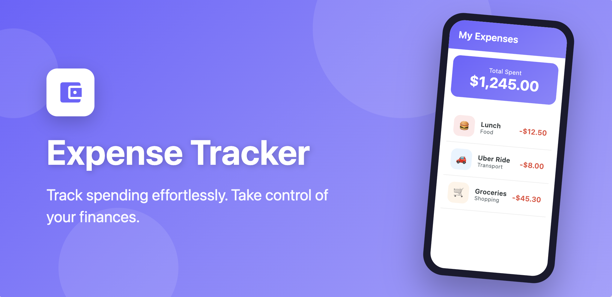
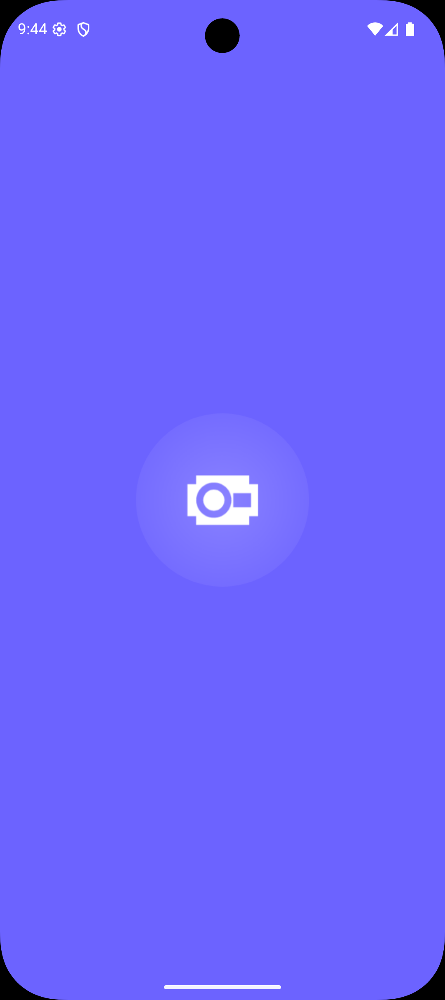
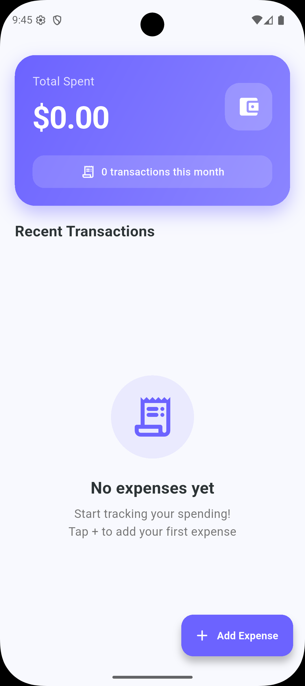
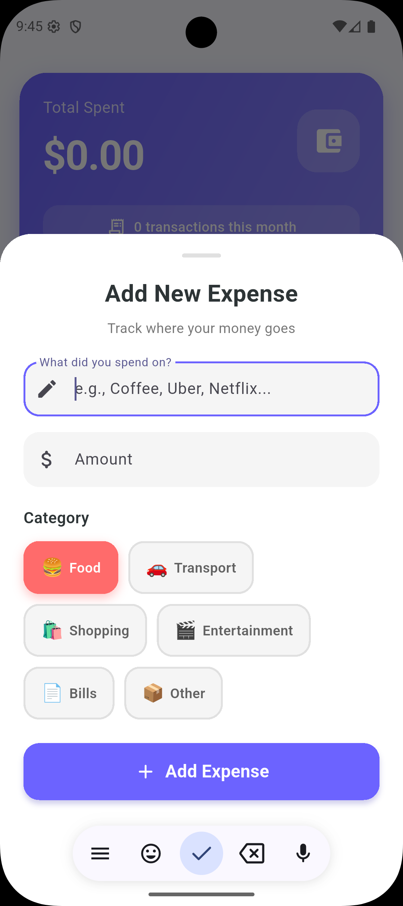
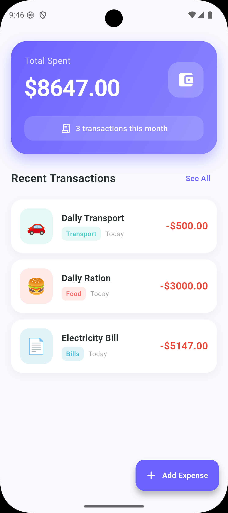
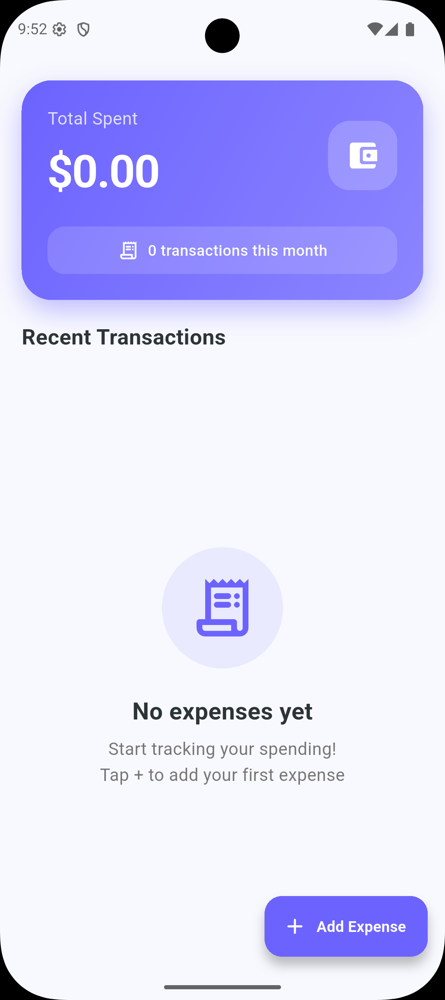

<p align="center">
  
</p>

<h1 align="center">Expense Tracker</h1>

<p align="center">
  A focused, elegant Flutter app for recording day-to-day spending at a glance.
</p>

<p align="center">
  
  
  
  
</p>

<p align="center">
  
</p>

## Overview

Expense Tracker makes it quick to capture an expense, assign it a category, and see the running total. The interface is built with Flutter and Material Design 3, with a polished empty state, category-aware transaction cards, and a lightweight developer profile screen.

## Features

- Add an expense with a description, amount, and category.
- Organize spending across Food, Transport, Shopping, Entertainment, Bills, and Other.
- See a running total and transaction count on the dashboard.
- Review recent transactions with category labels and dates.
- Remove a transaction with a swipe gesture.
- Use a responsive Material Design 3 interface on Android and iOS.
- Visit the in-app About screen to find the developer's social links.

> **Current data behavior:** transactions are kept in memory for the active app session. They are not saved to a database or sent to a server, so they reset when the app is restarted.

## Screenshots

<p align="center">
  
  
  
  
  
</p>

## Tech Stack

| Area | Technology |
| --- | --- |
| Framework | Flutter |
| Language | Dart |
| UI | Material Design 3 |
| Supported targets | Android and iOS |
| External links | [`url_launcher`](https://pub.dev/packages/url_launcher) |

## Getting Started

### Prerequisites

- [Flutter SDK](https://docs.flutter.dev/get-started/install) with Dart `3.10` or later
- An Android emulator/device or an iOS simulator/device (macOS required for iOS builds)

Confirm your local environment is ready:

```bash
flutter doctor
```

### Run locally

```bash
git clone <your-repository-url>
cd expense_tracker
flutter pub get
flutter run
```

To select a specific connected device, first run `flutter devices`, then use:

```bash
flutter run -d <device-id>
```

## Quality Checks

Run static analysis and the test suite before opening a pull request:

```bash
flutter analyze
flutter test
```

## Build a Release

```bash
# Android APK
flutter build apk --release

# Android App Bundle for Google Play
flutter build appbundle --release

# iOS archive (run on macOS)
flutter build ipa --release
```

Generated Android artifacts are placed in `build/app/outputs/`.

## Project Structure

| Path | Purpose |
| --- | --- |
| `.github/workflows/malware-scan.yml` | GitHub Actions workflow that runs the repository security scan. |
| `android/` | Android host project, Gradle configuration, and native resources. |
| `ios/` | iOS host project, Xcode configuration, and native resources. |
| `assets/icon.png` | Source image for the application icon and splash screen. |
| `assets/feature_graphic.png` | Feature graphic used in this README and for store presentation. |
| `assets/screenshots/` | Product screenshots displayed in the documentation. |
| `lib/main.dart` | Application entry point, interface, and in-memory expense state. |
| `scripts/scan-malware.cjs` | Node.js implementation invoked by the CI security workflow. |
| `test/widget_test.dart` | Flutter widget tests. |
| `analysis_options.yaml` | Dart and Flutter lint rules. |
| `pubspec.yaml` | App metadata, dependencies, and asset declarations. |
| `privacy-policy.html` | Standalone privacy-policy page. |
| `README.md` | Project documentation. |

## Privacy

Expense Tracker does not include a backend, account system, analytics SDK, or financial-data synchronization. Expense entries exist only during the active session. Read the included [privacy policy](privacy-policy.html) for the published policy text.

## Contributing

Contributions are welcome. For a focused change:

1. Create a branch from `master`.
2. Make the change and add or update tests where appropriate.
3. Run `flutter analyze` and `flutter test`.
4. Open a pull request with a concise description and screenshots for UI changes.

## License

This project is licensed under the [MIT License](LICENSE).

---
